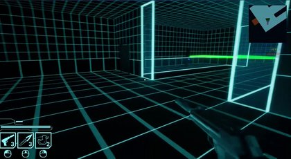
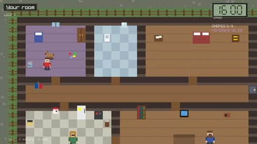
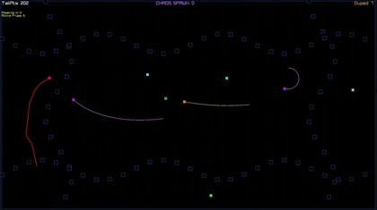
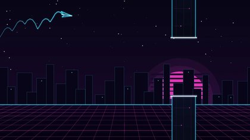

## Hi, I'm Noah 👋

I make games. I'm studying Programming and Game Design at INN in Hamar, Norway, and I run my own little studio, [Sund Origin Studio](https://sundorigin.org). Mostly C++, raylib and Unreal Engine 5. I usually end up leading the projects I'm on. I plan the work and then write most of the code.

🌐 [sundorigin.org](https://sundorigin.org) · 🎮 [itch.io](https://rillianz.itch.io) · ✉️ [Get in touch](https://sundorigin.org/contact.html)

### Games

<table>
<tr>
<td width="50%" valign="top">
 
<b><a href="https://github.com/RillianZ/metal-gears">Metal Gears</a></b> 
First person stealth in neon training sims. Unreal 5, C++ and Blueprints. Programming 2 exam, team project, I was lead programmer.
</td>
<td width="50%" valign="top">
 
<b><a href="https://github.com/RillianZ/600-seconds">600 Seconds</a></b> 
Time loop prototype. One hour, one house, a kid who remembers every loop. C++ and raylib in the browser. <a href="https://sundorigin.org/600-seconds.html">Play it</a>
</td>
</tr>
<tr>
<td width="50%" valign="top">
 
<b><a href="https://github.com/RillianZ/vector-clash">Vector Clash</a></b> 
Tron style light bike arena for 1 to 4 players. C++ and raylib. Programming 1 exam. <a href="https://sundorigin.org/vector-clash.html">Play it</a>
</td>
<td width="50%" valign="top">
 
<b><a href="https://github.com/RillianZ/flappy-plane">Flappy Plane</a></b> 
Flappy Bird with planes. The 2025 class versions and a neon remaster, one branch each. C++ and raylib. <a href="https://sundorigin.org/play.html">Play it</a>
</td>
</tr>
</table>

### Tools I use

C++ · raylib · Unreal Engine 5 · Blueprints · WebAssembly · Rider · Visual Studio · Git and Git LFS · Blender · ZBrush · Ableton

### Off the clock

Raver, traveller, handpan and piano player, 3D printer of things. Sci-fi and fantasy are my comfort food. Big dream: VR games, and one day a gaming café with a little community around it ^^
